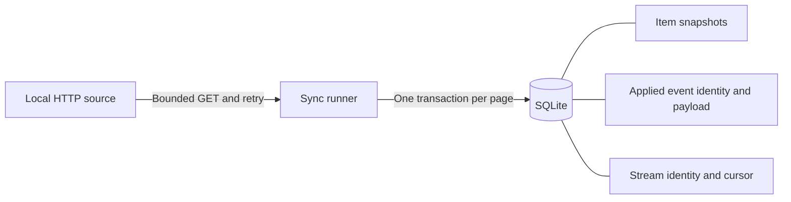

# Reliable Sync

[](https://github.com/PatrickSchaller/reliable-sync/actions/workflows/checks.yml)

A small .NET integration example: copy item updates from an HTTP source into SQLite, stop safely when something goes wrong, and resume from the last committed page.

The included source deliberately produces rate limits, outages, invalid data, and overlapping pages. The interesting part is the failure behavior, not the number of records copied.

This is an independent portfolio demonstration using invented data and a controlled source contract. It is not connected to an employer or a real ERP.

## Run it

Requires the latest patched .NET 10 SDK. From the repository directory:

```sh
dotnet build ReliableSync.slnx
dotnet src/ReliableSync/bin/Debug/net10.0/ReliableSync.dll source
```

Leave the source running on **http://127.0.0.1:5097**. In another terminal, from the same repository directory:

```sh
dotnet src/ReliableSync/bin/Debug/net10.0/ReliableSync.dll run data/demo.db fail
dotnet src/ReliableSync/bin/Debug/net10.0/ReliableSync.dll status data/demo.db
dotnet src/ReliableSync/bin/Debug/net10.0/ReliableSync.dll run data/demo.db healthy
dotnet src/ReliableSync/bin/Debug/net10.0/ReliableSync.dll status data/demo.db
dotnet src/ReliableSync/bin/Debug/net10.0/ReliableSync.dll run data/demo.db replay
```

Use a new database filename for the walkthrough. An existing sync database resumes its current state; it is never automatically reset.

| Step | Expected result |
| --- | --- |
| `run … fail` | First page commits; the next page exhausts three HTTP attempts and exits 1 |
| First `status` | Cursor 2, two applied events, two items |
| `run … healthy` | Resumes at cursor 2 and finishes at cursor 6 |
| Second `status` | Six applied events and four items |
| `run … replay` | Recognizes an already applied event; stock and event count stay unchanged |

Final quantities are `HW-104: 15`, `HW-208: 22`, `WD-310: 8`, and `WD-415: 36`. See [the captured command-line walkthrough](docs/walkthrough.json) for real output from separate worker processes.

## Scenarios

`run [database-path] [scenario]` defaults to `data/catalog.db` and `healthy`. `status [database-path]` prints a consistent read-only JSON snapshot. `source` starts the local simulator; `--help` shows the command syntax.

| Scenario | Source behavior |
| --- | --- |
| `healthy` | Up to two new events per page |
| `retry` | HTTP 429 with `Retry-After: 1`, then HTTP 503, then success for each cursor |
| `fail` | First page succeeds; requests after cursor 2 always return HTTP 503 |
| `invalid` | The second page includes an invalid quantity after a valid update |
| `replay` | Pages overlap an already applied event with the new events |

Use a separate database to try `retry` or `invalid` from the beginning. The simulator's retry counters live for the source process lifetime and are tracked per scenario and requested cursor.

## What is protected



**Page atomicity:** item snapshots, applied-event identities, and the checkpoint commit in the same immediate SQLite transaction. A failure in a later event or the checkpoint write rolls back the earlier writes from that page. This uses SQLite's transaction guarantees, rather than an in-memory lock. [Microsoft transaction documentation](https://learn.microsoft.com/en-us/dotnet/standard/data/sqlite/transactions)

**Replay safety:** event IDs and event cursors have durable uniqueness constraints. An already applied event must match its stored cursor and normalized payload. It is skipped before changing the destination item, so replaying an older snapshot cannot overwrite a newer one. Reusing an event ID with changed content stops the run.

**Checkpoint consistency:** a second worker cannot commit against a checkpoint that another run has already advanced. The losing run stops and can be rerun. This is a safety check, not a parallel-worker scheduler.

**Destination identity:** a SQLite application ID and format version distinguish this tool's database. An unrelated database or unsupported version is refused before schema or journal changes. The first accepted page also binds the database to one source stream ID.

**Bounded reads and retries:** one `HttpClient` is reused for the run. Each attempt has a five-second deadline covering headers and body, and a response limit of 64 KiB. HTTP 408, 429, 5xx, connection failures, body I/O failures, and timeouts can retry, for three attempts total. Other statuses and invalid JSON stop immediately. [Microsoft HttpClient guidance](https://learn.microsoft.com/en-us/dotnet/fundamentals/networking/http/httpclient-guidelines)

**Retry timing:** a valid `Retry-After` delta or HTTP date takes precedence. A wait longer than 30 seconds stops the run; the client does not shorten it and retry early. Without that header, the two retry waits are 250 ms and 500 ms. Tests replace only the delay function so retry behavior is deterministic without sleeping.

**Cancellation:** Ctrl+C cancels outstanding requests and retry waits. Page application checks cancellation before and during its transaction. Synchronous SQLite lock waits are bounded to three seconds. Inspect status and rerun after interruption.

## Source contract

The simulator exposes `GET /events/{scenario}?after=N` and returns HTTP 200 JSON with all fields required:

```json
{
  "streamId": "demo-catalog-v1",
  "requestedAfter": 0,
  "nextCursor": 2,
  "hasMore": true,
  "events": [
    { "cursor": 1, "eventId": "evt-001", "sku": "HW-104", "name": "Brass cabinet handle", "quantity": 10 },
    { "cursor": 2, "eventId": "evt-002", "sku": "HW-208", "name": "Steel corner bracket", "quantity": 24 }
  ]
}
```

- Cursors are positive, contiguous sequence numbers within this stream. New events begin at the requested cursor plus one.
- Event IDs, event cursors, and payloads are immutable. The returned events are strictly ordered; known earlier events may appear as overlap.
- The page's `requestedAfter` echoes the request. `nextCursor` equals the last newly consumed cursor, or the existing cursor when no new event is present.
- `hasMore` may be true only when the page advances. A page contains at most 20 events.
- IDs use ASCII letters, digits, dots, underscores, and hyphens. Event and stream IDs have an 80-character limit; SKUs have a 64-character limit. Names contain 1–200 characters without surrounding whitespace or control characters. Quantities are whole units from 0 to 1,000,000.

An unknown old event, a gap, changed stream identity, out-of-order data, or an inconsistent next cursor stops the run. These assumptions are explicit for this simulator. Existing APIs may use opaque cursors, snapshots, deletions, or different ordering; they need their own contract and adapter.

## Verify

```sh
dotnet restore ReliableSync.slnx --locked-mode
dotnet test ReliableSync.slnx --no-restore
```

The 41 tests use real temporary SQLite databases, deterministic HTTP handlers, and the real local HTTP simulator on an ephemeral port. They cover transaction rollback, source/destination identity, replay, concurrent checkpoint contention, invalid pages, network failures, retry limits and dates, cancellation, response limits, and failure followed by recovery.

One check deliberately makes the checkpoint write fail after item/event writes have been attempted, then reopens the database to verify that none of that page survived. This is an exception/rollback check, not a physical power-loss or forced-process-kill test.

The recorded walkthrough also verifies actual command exit statuses across separate worker processes. GitHub Actions runs the test suite on Linux and Windows. See [the validation record](docs/validation.md) for the verified results and their limits.

## Logs and exit codes

Worker logs are JSON lines containing event type, cursor, retry reason, and counts. They do not include response payloads or credentials. The explicit `status` command shows the invented item data.

| Exit | Meaning |
| --- | --- |
| 0 | Caught up, status printed, or help displayed |
| 1 | Sync or database failure; inspect status and fix the cause before rerunning |
| 2 | Invalid command or a missing database requested by `status` |
| 130 | Worker cancellation requested with Ctrl+C |

## Limits

One source stream and one SQLite destination, with a maximum of 100 pages per run. The tool uses full item snapshots rather than additive quantities. It has no deletion/tombstone processing, bidirectional synchronization, real-source credentials, background scheduling, or management UI. The source binds to loopback and contains only invented data.

Database identity and history are application safeguards, not protection against someone deliberately editing the SQLite file. For a backup, stop workers and copy the whole data directory; do not copy only a live database file while its write-ahead log may contain changes.

Before presenting this as an integration for a real system, review that system's cursor and identity guarantees, authentication, retention, retry policy, and operating requirements. This demonstration does not promise end-to-end exactly-once delivery across independent systems.

## Development disclosure

The initial implementation was prepared with Codex assistance. The code, source assumptions, failure scenarios, and automated checks are included for review and modification. No employer code or data was used.

## License

MIT. See [LICENSE](LICENSE).
